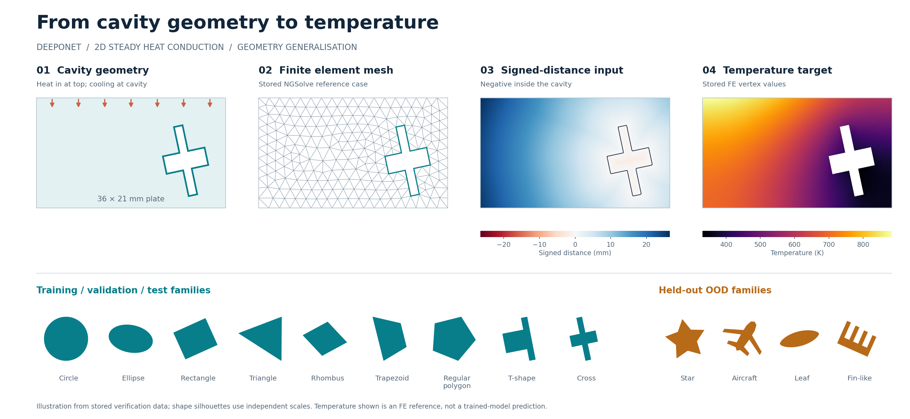

# DeepONet for heat conduction across cavity geometries



Learn the temperature field in a plate from the shape of its cooling cavity.
This repository uses **DeepONet**, trained on finite element solutions from
**NGSolve**, to study accuracy, training-data requirements and generalisation to
unseen geometry families.

One entry point, `run.py`, covers the complete experiment:

1. Generate reusable FE datasets and check their separation.
2. Tune network depth, width, activation and learning rate using validation data.
3. Train the selected model at five dataset sizes with five random seeds.
4. Evaluate fixed test cases and out-of-distribution (OOD) shapes.
5. Produce figures, error tables, scaling curves and timing reports.

The organisation and experiment sequence follow the DeepONet study in
[Feature_Extraction](https://github.com/prajwal1798/Feature_Extraction/tree/6c0d0e14af01d48dadb2fd4b485c7a61c21a205e),
adapted here for multiple training families and separate OOD geometries.

**Start here:** [Windows / VS Code](docs/manual/commands_windows.txt) ·
[WSL / Linux](docs/manual/commands_wsl.txt) ·
[Sunbird HPC](docs/manual/commands_sunbird.txt) ·
[Study settings](docs/manual/study.example.json)

> **Every training size is per geometry family.** With nine families, `N = 50`
> means **450 training cases**. Validation and test cases are additional and
> remain fixed throughout the size study.

---

## The problem

Steady heat conduction in a plate with a single cooling cavity:

$$
-\nabla \cdot (k\nabla T) = 0 \qquad \text{in the solid plate.}
$$

| Quantity | Default |
|---|---|
| Plate dimensions | 36 mm × 21 mm |
| Thermal conductivity | 28.3 W/(m K) |
| Top edge | Inward heat flux of 0.5 MW/m² |
| Cavity wall | Convection: $-k\,\partial T/\partial n = h(T-T_\infty)$ |
| Convection coefficient / ambient temperature | 4,000 W/(m² K) / 300 K |
| Remaining outer edges | Adiabatic |
| Reference solver | NGSolve, second-order H1 finite elements |
| FE mesh setting | `maxh = 0.0008 m`; inspect convergence for the chosen shapes |
| Network grid | 128 × 96 points |

The **branch network** receives the cavity signed-distance field (SDF) over the
whole grid. The **trunk network** receives normalised coordinates and the local
SDF value at each query point. Their combined output is the temperature field.
Training losses and reported errors use the solid region only.

### Geometry families

| Dataset group | Families |
|---|---|
| Training, validation and test | Circle, ellipse, rectangle, triangle, rhombus, trapezoid, regular polygon, T-shape, cross |
| OOD evaluation | Star, aircraft, leaf, fin-like |

Dimensions, placement and rotation vary within the ranges in
[`src/config.py`](src/config.py). Validation and test use the training families
and ranges, with distinct geometry cases. OOD families are excluded from training
and model selection. The banner shows an FE reference, not model predictions;
family silhouettes are drawn at independent scales.

### One dataset, nested training sizes

| Part | Cases per family | Default total | Sampling | Use |
|---|---:|---:|---|---|
| Maximum training pool | 800 | 7,200 across 9 families | Halton | Nested training prefixes |
| Validation | 50 | 450 across 9 families | Fixed, seeded LHS | Early stopping and tuning |
| Test | 50 | 450 across 9 families | Separate fixed LHS | Final in-distribution errors |
| OOD | 20 | 80 across 4 families | Separate fixed LHS | Unseen-family errors |

The master in-distribution dataset contains **8,100 cases**, generated once.
OOD datasets are stored separately. The size study reuses these training prefixes:

| Training cases per family | 50 | 100 | 200 | 400 | 800 |
|---|---:|---:|---:|---:|---:|
| Total training cases, 9 families | 450 | 900 | 1,800 | 3,600 | 7,200 |

Canonical geometry checks reject duplicates across the selected datasets before
FE solving, during composition and when loading data. They compare geometry
identities, including relevant shape symmetries, rather than filenames or row
numbers. See the [sampling protocol](docs/manual/study_workflow.md#sampling-and-separation)
for the identity tolerance and how rejected LHS candidates are replaced.

---

## What is in the repository

| Path | Contents |
|---|---|
| [`run.py`](run.py) | Single entry point: `python run.py STAGE OPTIONS` |
| [`src/config.py`](src/config.py) | Physics, geometry ranges, grid and study defaults |
| [`src/fem/`](src/fem/) | Geometry registry, boundaries, SDF, mesh, solver and FE storage |
| [`src/data/`](src/data/) | Sampling, reusable FE cache, composition, splits and scaling |
| [`src/models/`](src/models/) | Configurable DeepONet branch and trunk networks |
| [`src/training/`](src/training/) | Training, checkpoint recovery, tuning and dataset-size runs |
| [`src/analysis/`](src/analysis/) | Metrics, previews, reports, mesh checks, ANSYS export and benchmarks |
| [`jobs/sunbird/`](jobs/sunbird/) | Generic CPU and GPU Slurm launchers |
| [`tests/`](tests/) | Numerical and study-protocol regression checks |
| [`docs/manual/`](docs/manual/) | Platform guides and study configuration |
| [`docs/figures/`](docs/figures/) | README illustration and its plotting script |
| [`archive/`](archive/) | Historical code; use the root CLI for the current workflow |

The code creates `data/`, `outputs/` and `verification/`. Generated datasets,
checkpoints and study results are excluded from Git.

## Documentation

| Guide | Purpose |
|---|---|
| [Windows / VS Code](docs/manual/commands_windows.txt) | PowerShell setup and the complete local study |
| [WSL / Linux / VS Code](docs/manual/commands_wsl.txt) | Bash setup and the same study sequence |
| [Sunbird HPC](docs/manual/commands_sunbird.txt) | Environment, Slurm arrays, job dependencies and monitoring |
| [Study protocol](docs/manual/study_workflow.md) | Sampling, selection, normalisation, restarting and output files |
| [Adding a training shape](docs/manual/adding_geometry.md) | Registry interface and a complete kite-shaped cavity example |
| [Verification record](docs/manual/verification.md) | Executed checks and platform limitations |

Follow the platform command files from top to bottom. Windows commands use
**PowerShell**; WSL and Sunbird commands use **Bash**. In VS Code, select the
corresponding project Python environment.

---

## 1. Installation

Open a terminal in the repository root. Use a separate Python environment:
Python 3.11 or later with compatible NumPy, Matplotlib, NGSolve and PyTorch
versions, as specified in [`requirements.txt`](requirements.txt).

**Windows — PowerShell**

```powershell
py -3.11 -m venv .venv
.\.venv\Scripts\Activate.ps1
```

If activation is restricted, invoke `.\.venv\Scripts\python.exe` directly in
place of `python`.

**WSL / Linux — Bash**

```bash
python3 -m venv .venv
source .venv/bin/activate
```

For WSL, keep the checkout and large datasets on the Linux filesystem.

Choose the CPU or CUDA build from the
[official PyTorch installation selector](https://pytorch.org/get-started/locally/),
install it in the environment, then run:

```text
python -m pip install -r requirements.txt
python run.py gpu-info
```

The default `device = "auto"` uses CUDA when available and otherwise uses CPU.
Use `--device cpu` or `--device cuda` to request a specific device. FE generation
runs on the CPU. Cluster setup is covered in the [Sunbird guide](docs/manual/commands_sunbird.txt).

## 2. Check the installation and choose settings

```text
python tests/run_all.py
python run.py smoke
python run.py --help
```

The smoke test runs a miniature complete study: Tanh/GELU/LR selection, two sizes,
two seeds and OOD evaluation. It writes to `verification/`; its two-epoch models
are execution checks, not research results.

Copy the example configuration **once**, then edit `study.json` before generating
the production data:

**PowerShell**

```powershell
Copy-Item docs/manual/study.example.json study.json
```

**Bash**

```bash
cp docs/manual/study.example.json study.json
```

Use `--config study.json` throughout. The following commands use the example
counts and seeds; update run names and report sizes if you change them. Paths
inside the JSON resolve from the repository root.

## 3. The full study, step by step

Run each command from the repository root, in the order shown.

### Step 1 — Generate and inspect the data

```text
python run.py generate --config study.json
python run.py generate-ood --config study.json
python run.py plot-sampling --config study.json
python run.py preview --config study.json --family circle --case 0
python run.py mesh-check --config study.json
```

`generate` builds per-family sources, composes the master dataset and checks
separation. Previews show geometry, mesh, SDF, mask and temperature. `mesh-check`
compares three meshes for a representative case per training family and records
heat balance. Successful FE cases are cached and reused on restart or extension.

### Step 2 — Check one short model (optional)

```text
python run.py train --config study.json --train-size 200 --seed 321 --run-name try_deeponet --epochs 300
python run.py evaluate --config study.json --run-name try_deeponet --split val
python run.py plot --config study.json --run-name try_deeponet --split val
```

This separate run uses validation results and does not enter the final reports.

### Step 3 — Tune depth, width, activation and learning rate

Tuning uses **200 training cases per family** by default: 1,800 across nine
families. Keep this order:

```text
python run.py tune --config study.json --stage-name grid
python run.py tune-select --config study.json --stage-name grid

python run.py tune --config study.json --stage-name grid_gelu
python run.py tune-select --config study.json --stage-name grid_gelu

python run.py tune --config study.json --stage-name lr
python run.py tune-select --config study.json --stage-name lr
```

| Stage | What changes | Default runs |
|---|---|---:|
| `grid` | Tanh; hidden layers 2/4/6/8/10 × neurons 10/20/40/80/160 | 25 |
| `grid_gelu` | The same depth/width grid with GELU | 25 |
| `lr` | LR 0.0003/0.001/0.003 at the better activation-grid winner | 3 |

Branch and trunk share the grid's hidden depth and width; the final latent
projection has width 128. Both activation grids start at LR 0.001. Tuning uses
seed **123** and at most **2,000 epochs** per run.

- **Best epoch:** lowest validation masked MSE.
- **Best configuration:** lowest mean validation case-relative L2 using
  temperatures in kelvin. RMSE and R² are also reported.
- **Consistent comparisons:** selection rejects missing runs, stale metrics and
  inconsistent training settings. Test and OOD errors do not select a winner.

### Step 4 — Freeze the model and run the dataset-size study

```text
python run.py train-scaling --config study.json
```

This runs **5 sizes × 5 seeds = 25 models**, using the selected architecture,
activation and initial LR at every size. Each run evaluates the same fixed test set.

| Setting | Default |
|---|---|
| Training cases per family | 50, 100, 200, 400, 800 |
| Training seeds | 321, 777, 2026, 31415, 27182 |
| Maximum epochs | 5,000 per run |
| Optimiser / batch size | Adam / 8 |
| Loss | Masked, point-weighted MSE over solid points |
| Gradient clipping | Norm 1 |
| LR scheduler | ReduceLROnPlateau; factor 0.5, patience 200 |
| Early stopping | 800 epochs without validation improvement |

### Step 5 — Create reports

```text
python run.py scaling-report --config study.json
python run.py summarize --config study.json --train-size 50
python run.py summarize --config study.json --train-size 100
python run.py summarize --config study.json --train-size 200
python run.py summarize --config study.json --train-size 400
python run.py summarize --config study.json --train-size 800
```

Reports include seed variability, family errors and test error versus training
size. A power law $e = C N^{-\alpha}$ is fitted to the seed-mean error, with
**N measured per family**. Error bars describe variation across model seeds on
the fixed test cases.

### Step 6 — Inspect predictions, OOD errors and timing

For one completed final run:

```text
python run.py plot --config study.json --run-name scale_deeponet_N0800_seed321 --case 0
python run.py evaluate-ood --config study.json --run-name scale_deeponet_N0800_seed321
python run.py benchmark --config study.json --run-name scale_deeponet_N0800_seed321
```

Repeat OOD evaluation across sizes and seeds to study OOD scaling; the platform
guides include loops. Benchmarking records hardware, epoch and prediction times.
Run it on an otherwise idle device for interpretable timings.

---

## 4. On Sunbird HPC

The [Sunbird guide](docs/manual/commands_sunbird.txt) provides the full submission
sequence, including `afterok` dependencies between generation, tuning, selection
and final training. After setting `STUDY_ENV` and `STUDY_ACCOUNT` as described there:

```bash
mkdir -p outputs/slurm
sbatch --account="$STUDY_ACCOUNT" jobs/sunbird/cpu.sh generate --config study.json
```

After successful data generation, a 25-cell grid can run as a GPU job array:

```bash
sbatch --account="$STUDY_ACCOUNT" --array=0-24 --output=outputs/slurm/tanh_%A_%a.out jobs/sunbird/gpu.sh tune --config study.json --stage-name grid
```

The launchers pass their arguments to `run.py`. Tuning task `k` selects cell `k`;
for the default size study, it selects size index `k // 5` and seed index `k % 5`.
Change array bounds when changing the number of cells, sizes or seeds. Concurrency
depends on the cluster allocation.

| Command | Purpose |
|---|---|
| `squeue -u "$USER"` | Inspect waiting and running jobs |
| `sacct -j JOB_NUMBER --format=JobID,State,ExitCode,Elapsed` | Inspect completion, failures and elapsed time |
| `tail -F outputs/slurm/tanh_JOB_NUMBER_0.out` | Follow one task's output |

Check account, partition, GPU and module settings against your allocation.
Starting defaults are `compute` for CPU jobs and `accel_ai` / A100 for GPU jobs.

## 5. Where the results go

`TAG` means `design_space_<composition ID>`. `RUN` identifies a tuning cell or
size/seed combination, for example `scale_deeponet_N0800_seed321`.

| Artifact | Location |
|---|---|
| Per-family sources and FE cache | `data/geometry_datasets/FAMILY/design_ID/` |
| Master dataset and composition manifest | `data/composed_datasets/mix_ID/` |
| OOD sources | `data/ood_datasets/FAMILY/design_ID/` |
| Best / recovery model | `outputs/checkpoints/TAG/RUN/best_model.pt`, `last_checkpoint.pt` |
| Loss history, timings, settings and hardware | `outputs/logs/TAG/RUN/` |
| Validation, test and OOD metrics | `outputs/study_results/TAG/RUN/` |
| Loss and prediction figures | `outputs/figures/TAG/RUN/` |
| Tuning tables and selected settings | `outputs/study_results/TAG/tuning/Nxxxx_per_family/` |
| Tuning heatmaps and seed/family reports | `outputs/figures/TAG/report/Nxxxx_per_family/` |
| Scaling curve, CSV and fitted rates | `outputs/figures/TAG/report/` |

Study figures default to PDF and 600 dpi PNG, with metrics in CSV/JSON. Use
`--no-pdf` or `--dpi` for exploratory runs. Case-filtered evaluations write
`selected_*` metrics, preserving full-split results.

## 6. Options, new shapes and restarting

### Configure a study

Edit your local `study.json`, copied from the [example](docs/manual/study.example.json).
For the standard workflow, set `geometry_cases_per_family`,
`training_geometry_source_sizes` and `training_geometry_counts` to each family's
maximum pool size. Every selected size must fit within all included families' pools.

| Setting / option | Meaning |
|---|---|
| `generate_geometry_families` | Training families to generate |
| `training_geometry_counts` | Contribution to the master composition; zero excludes a family |
| `validation_cases_per_family`, `test_cases_per_family` | Fixed holdout counts |
| `scaling_sizes`, `tuning_size` | Per-family sizes for final runs and tuning |
| `study_seeds`, `tuning_seeds` | Final-run and tuning seeds |
| `--train-size N` | Select N cases per included family from the saved master pool |
| `--cases N` | Change generated pool and matching source/composition counts |
| `--families circle,ellipse` | Select families; use consistently throughout that study |

`--train-count` changes the master composition. Use `--train-size` for the size
study so its master dataset and temperature scaler stay fixed. Run
`python run.py --help` for the complete option list.

### Add a training shape

Register its parameter mapper, boundary builder, sampling dimension, stable seed
offset and version in [`src/fem/custom_shapes.py`](src/fem/custom_shapes.py).
Add the family to the configuration's lists and count maps. The shared generation,
training and reporting pipeline discovers the registration.

[Adding a training geometry](docs/manual/adding_geometry.md) provides a complete
example. Existing source datasets remain reusable; including a new family creates
a new composition for new model runs.

### Continue interrupted work

| Stage | How to continue |
|---|---|
| `generate` / `generate-ood` | Repeat the command; completed FE cases are reused |
| `tune` / `train-scaling` | Repeat; matching completed runs are skipped and interrupted runs resume |
| `train` / `train-final` | Repeat the original command with `--resume` |

Recovery checkpoints save every 50 epochs by default, including optimiser,
scheduler and Torch/loader random states. Choose a new run name for changed
training settings. Avoid concurrent writers for the same generation or model run.

Increasing the maximum pool reuses FE solutions but creates a new master dataset
and may change its temperature scaler. Run a new complete comparison under that
larger study. Details are in the [protocol guide](docs/manual/study_workflow.md).

## 7. Reproducibility and verification

- **Sampling:** nested Halton prefixes, fixed seeded LHS holdouts and OOD designs,
  and explicit geometry overlap checks.
- **Scaling:** temperature min/max use solid points in the maximum training pool,
  fixed across sizes. SDF mean/std use each run's selected training cases.
  Validation, test and OOD do not fit either scaler.
- **Provenance:** dataset/checkpoint fingerprints guard loading, selection and
  reports. Runs record settings, splits, seeds and hardware.
- **Numerics:** FP32, TF32 disabled and deterministic Torch algorithms enabled.
  CPU resume equivalence is tested; cross-device/version bitwise equality is not assumed.
- **Process separation:** FE generation and neural-network stages run separately
  to avoid native-library conflicts in affected Windows environments.

The workflow passed **25 regression tests**, the miniature CPU study, GPU checks,
a new-shape example and relocated-data evaluation. WSL and live Sunbird execution
remain unverified. Full research runs have not been performed. See the
[verification record](docs/manual/verification.md).

Historical checkpoints belong to their original workflow and cannot resume the
current configurable study. Migration backups preserve the preceding source.

## Attribution and licence

Model, training/runtime and benchmark code adapt
[prajwal1798/Feature_Extraction](https://github.com/prajwal1798/Feature_Extraction),
commit `6c0d0e14af01d48dadb2fd4b485c7a61c21a205e`, under GNU GPL v3. The geometry
and thermal problem come from the original `DeepOnet_2D_OOD_Study`.

See [`ATTRIBUTION.md`](ATTRIBUTION.md) and [`LICENSE`](LICENSE).
